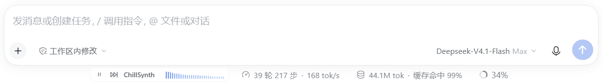
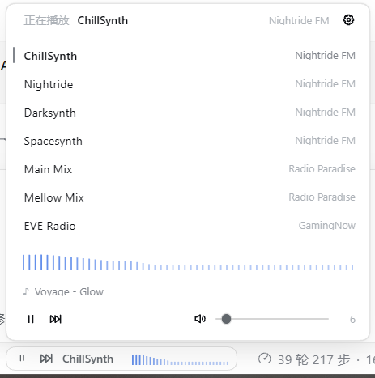
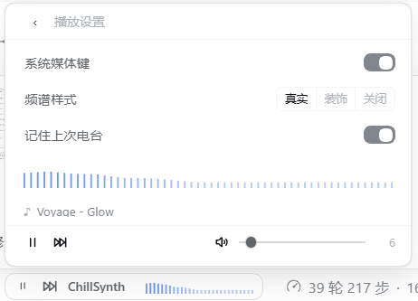

# DSH 电台 · dsh-plugin-radio

[](https://github.com/CXZAAA/dsh-radio/actions/workflows/ci.yml) [](LICENSE)

**在 DSH Web GUI 里边工作边听的网络电台。** 一条 24px 的胶囊嵌在 composer 状态行里，和轮次、token 那些状态并排；点一次出声，切台、暂停、音量、曲目都在它自己的面板里。

*Internet radio for the DeepSeek-Harness Web GUI — a 24px capsule in the composer status row.*



## 安装

### 方式一：在 dsh 里直接装（推荐）

1. 侧边栏 **插件 → 添加插件**；
2. 粘贴仓库地址并安装：

   ```
   https://github.com/CXZAAA/dsh-radio
   ```

3. 如果提示 `restart-required`，重启一次再刷新：

   ```bash
   sudo systemctl restart dsh-web
   ```

包内声明了组合包 patch，插件页会自动加好 Loader 行并默认启用，不需要手改配置。

<details>
<summary>之前用脚本装过？先清掉旧的那份</summary>

```bash
dsh plugin --profile web remove dsh-plugin-radio
```

再删掉 `~/.dsh/profiles/web/cordis.patch.yml` 末尾 `# dsh-radio (managed by install-local.sh)` 那一段，避免同一行被写两次。
</details>

### 方式二：克隆后用脚本

```bash
git clone https://github.com/CXZAAA/dsh-radio.git
cd dsh-radio
bash scripts/install-local.sh
sudo systemctl restart dsh-web
```

仓库已提交 `lib/` 构建产物，不需要在本地构建。

<details>
<summary>其他安装方式与卸载</summary>

**pnpm git 安装**（未在 CI 中验证；`github:` 简写默认走 SSH，没有 key 会卡住，用 `git+https://`）：

```bash
dsh plugin --profile web add "git+https://github.com/CXZAAA/dsh-radio.git"
```

之后手动在 `~/.dsh/profiles/web/cordis.patch.yml` 追加：

```yaml
# dsh-radio
- insert:
    - id: radio
      name: dsh-plugin-radio
```

**卸载**：

```bash
dsh plugin --profile web remove dsh-plugin-radio
```

并删掉上面那段 `id: radio`，重启 dsh-web。
</details>

## 能做什么

- **7 个预置电台**：Nightride FM 四个频道、Radio Paradise 两个频道、EVE Radio。
- **切台干净**：先停旧流再起新流，不会叠音；主地址失败静默切备用地址一次，12 秒没出声才算失败。
- **首声尽可能快**：只预热一条流（上次听的那台），点击时复用同一个音频元素。
- **真实频谱**：AnalyserNode 采样，收起态 28 根小方柱，面板里一条 56 根的频谱带。
- **当前曲目**：Nightride 直读 Icecast，Radio Paradise 走宿主只读路由，面板里显示 `歌手 — 曲名`。
- **记住状态**：上次电台、音量、静音、设置都存在浏览器本地。
- **不打扰**：只用 `--dsw-*` 主题变量，明暗主题都成立；颜色只出现在频谱柱和失败态。

## 用起来

| 操作 | 结果 |
| --- | --- |
| 点胶囊左端 | 播放 / 暂停（失败时变成重试） |
| 点「下一台」 | 切到下一台，7 台循环 |
| 点台名 | 向上弹出面板 |
| 面板里点某台 | 切过去；点当前台是暂停 / 恢复 |
| 面板右上角齿轮 | 系统媒体键、频谱样式、记住上次电台 |
| 底部一行 | 左侧播放 / 下一台，右侧静音 + 音量滑杆 |
| `Esc` | 关闭面板 |

<table>
<tr>
<td width="50%"></td>
<td width="50%"></td>
</tr>
<tr>
<td align="center">面板：电台列表、频谱、当前曲目</td>
<td align="center">设置：三项开关</td>
</tr>
</table>

## 电台

| 电台 | 来源 | 流 |
| --- | --- | --- |
| ChillSynth | [Nightride FM](https://nightride.fm/) | MP3 320 |
| Nightride | [Nightride FM](https://nightride.fm/) | MP3 320 |
| Darksynth | [Nightride FM](https://nightride.fm/) | MP3 320 |
| Spacesynth | [Nightride FM](https://nightride.fm/) | MP3 320 |
| Main Mix | [Radio Paradise](https://radioparadise.com/) | AAC 320 |
| Mellow Mix | [Radio Paradise](https://radioparadise.com/) | AAC 128 |
| EVE Radio | [GamingNow](https://gamingnow.net/eve-radio/) | MP3 256 |

全部是浏览器直放的渐进式流，没有 HLS、不需要音频代理。

## 已知限制

- 入口只在对话面板可见；切到轨迹等其他主面板时入口消失，播放不中断。
- EVE Radio 的 Icecast 没有有效 title，所以不显示曲目。
- EVE Radio 的备用地址是 `http://`，dsh 跑在 HTTPS 下时会被混合内容策略拦掉。
- Nightride 没有低码率 MP3，移动网络首声依赖预缓冲。
- Radio Paradise 的曲目信息需要宿主半侧的小路由；改了宿主代码要重启 dsh 才生效。
- 不支持自定义电台（v0.1 的范围）。

## 开发

```bash
pnpm install
pnpm typecheck   # tsc --noEmit
pnpm build       # esbuild → lib/client.js + lib/index.js
pnpm test        # node:test：45 项，含 ModuleLoader 冒烟与宿主路由
```

客户端半侧支持 HMR：改完 `pnpm build` 会自动推进已打开的页面；宿主半侧改动需要重启 dsh。

<details>
<summary>包结构</summary>

```
src/
  index.ts             # 宿主半侧：注册 /plugins/dsh-plugin-radio/now-playing（RP 曲目代理）
  client/
    index.ts           # name / inject: ['slots'] / apply(ctx)
    stations.ts        # 7 个电台与主备地址
    settings.ts        # 设置与 localStorage 解析
    i18n.ts            # 中文（默认）/ 英文
    player.ts          # 单例 Audio、预缓冲、超时、备用流、AnalyserNode
    nowPlaying.ts      # Nightride / EVE / RP 三条曲目来源
    store.ts           # 模块级 store + MediaSession + 持久化
    Radio.tsx          # 状态行胶囊 / 面板 / 设置
    styles.ts          # CSS 字符串与 <style data-dsh-radio> 注入
lib/
  client.js            # window.__ModuleLoader__.load({ id, factory })
  index.js             # 宿主半侧产物
locale/{zh,en}.json    # 插件页显示的标题与描述
cordis.patch.yml       # 组合包 patch：插入 id: radio
```
</details>

## 文档

- [GLOSSARY.md](GLOSSARY.md)：电台条目 / 来源 / 预置 / 备用流 / 首声 / 预缓冲
- [docs/spec-v0.1.md](docs/spec-v0.1.md)：实现任务书
- [docs/acceptance-log.md](docs/acceptance-log.md)：验收清单与证据
- [docs/network-probe.md](docs/network-probe.md)：中国大陆可达性与码率实测
- ADR：[0001 浏览器直放](docs/adr/0001-browser-direct-playback.md) · [0002 投放位置](docs/adr/0002-placement-in-composer-dock.md) · [0003 曲目来源](docs/adr/0003-now-playing-metadata.md)
- `design/`：方向稿、可交互原型、harness 截图

## License

MIT © 2026 CXZAAA
