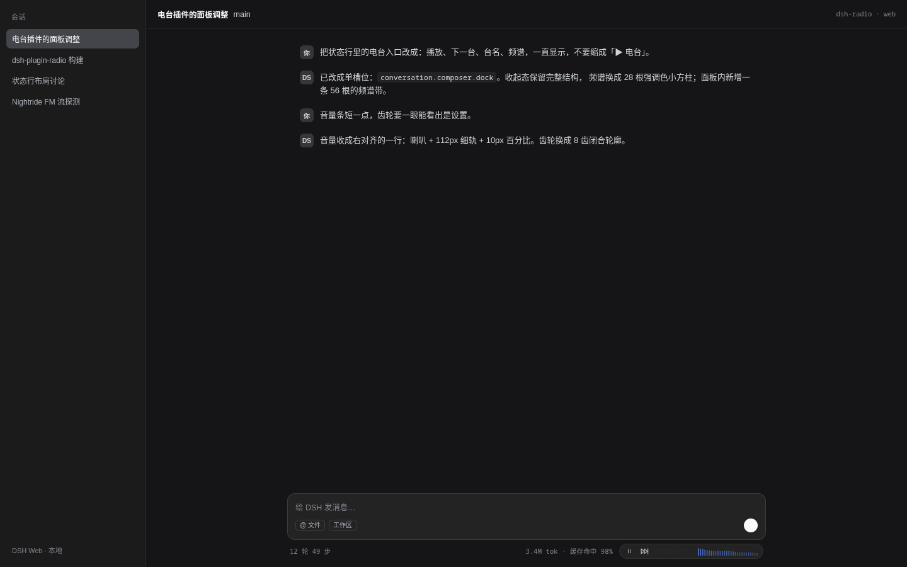
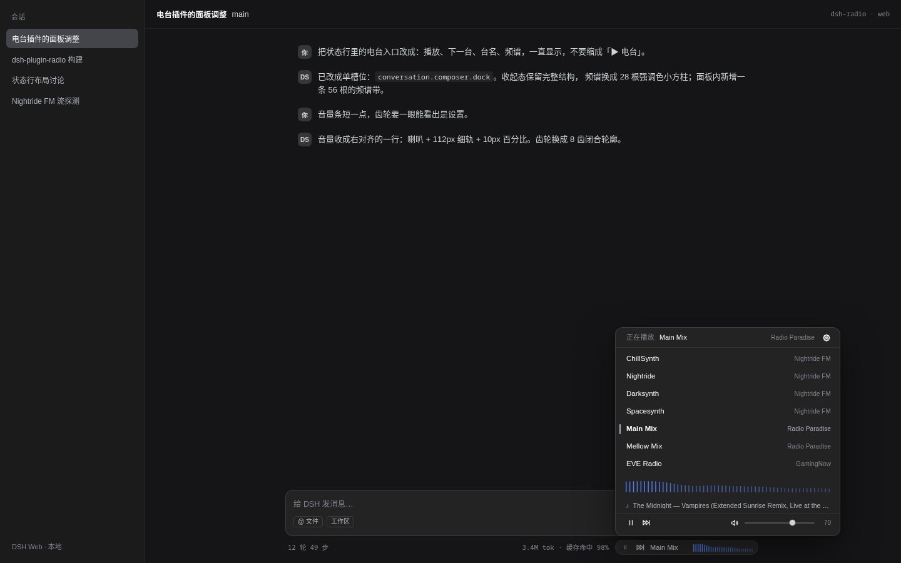

# dsh-plugin-radio

[](https://github.com/CXZAAA/dsh-radio/actions/workflows/ci.yml)

Ambient internet radio for the DeepSeek-Harness Web GUI. A 24px capsule sits in the composer status row, next to the turn and token pills: one click starts playing, and station switching, pause, volume and settings live in that strip and its popover. Seven preset stations (Nightride FM, Radio Paradise, EVE Radio), real FFT spectrum, MediaSession keys, now-playing metadata and remembered state. Audio is browser-direct — the host only proxies Radio Paradise's track JSON. MIT licensed.

在 DSH Web GUI 里边工作边听的网络电台。入口是一条 24px 的胶囊，默认嵌在 composer 下方的状态行里，与轮次、token 两个状态胶囊并排；点一次出声，切台、暂停、音量和设置都在同一条细条与它的面板里完成。

## 功能

- **7 个预置电台**：ChillSynth、Nightride、Darksynth、Spacesynth（Nightride FM），Main Mix、Mellow Mix（Radio Paradise），EVE Radio（GamingNow）。音频全部由浏览器直放；宿主只代理 Radio Paradise 的曲目 JSON。
- **一个位置**：24px 胶囊嵌在 composer 状态行里，与轮次、token 两个状态胶囊并排。
- **播放**：单例音频元素复用；切台先停旧流；只预缓冲上次播放的电台；12 秒未出声自动切备用地址一次；失败后点击重试。
- **频谱**：真实（AnalyserNode，28 根小方柱，面板内 56 根）、装饰（固定节奏伪随机）、关闭。
- **系统媒体键**：开关控制 MediaSession 的 metadata 与 play / pause / stop handler。
- **当前曲目**：Nightride 四个台与 EVE 直读 Icecast stats，Radio Paradise 经宿主只读路由取元数据；面板里频谱带下方一行 `Artist — Title`，无数据时不占位（见 [ADR-0003](docs/adr/0003-now-playing-metadata.md)）。
- **记忆**：上次电台、音量、静音位、设置都写入 localStorage。
- **主题**：全部使用 `--dsw-*` 主题变量，明暗主题都成立；颜色只出现在频谱柱与失败态。

不做：自定义电台、定时关闭、录音、歌词。音频仍由浏览器直放，宿主只代理 RP 的曲目 JSON（见 ADR-0003）。

## 安装 / Installation

要求：已安装并运行 dsh web，Node 22+，pnpm。

### A. 从 GitHub 安装（推荐：克隆后用脚本）

```bash
git clone https://github.com/CXZAAA/dsh-radio.git
cd dsh-radio
bash scripts/install-local.sh
sudo systemctl restart dsh-web
```

脚本会把仓库 `link:` 进 web profile，并幂等追加 Loader 行（`id: radio`）。仓库已提交 `lib/` 构建产物，不需要在本地构建。

<details>
<summary>也可以直接用 pnpm 的 git 安装（未在 CI 中验证）</summary>

```bash
dsh plugin --profile web add "git+https://github.com/CXZAAA/dsh-radio.git"
```

首次安装后，手动在 `~/.dsh/profiles/web/cordis.patch.yml` 追加 Loader 行，再重启 dsh-web：

```yaml
# dsh-radio
- insert:
    - id: radio
      name: dsh-plugin-radio
```

注意：`github:` 简写在 pnpm 里默认走 SSH，没有 GitHub SSH key 的机器会卡住；用上面的 `git+https://` 形式。这条路径依赖 pnpm 能拉到仓库，未在本仓库 CI 中验证，失败时请改用上面的克隆脚本。
</details>

### B. 本地开发安装

1. 构建：

   ```bash
   cd /path/to/dsh-plugin-radio
   npm_config_cache="$PWD/.cache/npm" pnpm install
   pnpm build
   ```

   `pnpm-workspace.yaml` 已把 store/cache 指到仓库内（`.pnpm-store/`、`.cache/pnpm/`），不依赖 `$HOME` 写权限。

2. 安装到 web profile：

   ```bash
   bash scripts/install-local.sh
   ```

   脚本会做三件事：

   - `dsh plugin --profile web add "link:$PWD"`；失败时回退到在 profile 目录执行 `pnpm add "link:$PWD"`。
   - 往 `~/.dsh/profiles/web/cordis.patch.yml` 幂等追加 Loader 行（已有 `id: radio` 就跳过）：

     ```yaml
     # dsh-radio (managed by install-local.sh)
     - insert:
         - id: radio
           name: dsh-plugin-radio
     ```

   - 打印重启提示。脚本不会自动重启服务，也不会请求 sudo。

3. 重启并刷新：

   ```bash
   sudo systemctl restart dsh-web
   ```

   然后刷新 <http://127.0.0.1:3080>。

### 手动安装

```bash
dsh plugin --profile web add "link:/path/to/dsh-plugin-radio"
```

再编辑 `~/.dsh/profiles/web/cordis.patch.yml`，追加上面那段 YAML，重启 dsh-web。

### 卸载

```bash
dsh plugin --profile web remove dsh-plugin-radio
```

并删掉 `cordis.patch.yml` 中 `id: radio` 的那段 insert，重启 dsh-web。

## 使用

- **胶囊**：`播放/暂停 · 下一台 · 台名 · 频谱`，四段始终显示（未播放只换图标，不折叠）；连接中显示三点脉冲与低幅呼吸频谱。
- **面板**：点台名向上弹出 360px 面板，列出 7 个电台与来源，当前行左侧有 2px 灰线；点行切台，点当前行暂停/恢复。频谱带下方显示当前曲目（`Artist — Title`，过长省略），没有元数据时整行不出现。
- **底部一行**：左侧播放/暂停与下一台，右侧喇叭静音 + 112px 音量滑杆 + 百分比，立即生效并持久化。
- **设置**：面板右上角齿轮，包含系统媒体键、频谱样式、记住上次电台。
- **失败**：红点 + 「连接失败，点击重试」；点失败文案或播放符号重试，点胶囊的其余区域打开面板。
- **键盘**：Esc 关闭面板；系统媒体键在开关打开时可用。

刷新页面后，胶囊会显示上次播放的电台（暂停态），点一次即续播；关闭「记住上次电台」后刷新回到默认台 ChillSynth。

## 开发

```bash
pnpm typecheck   # tsc --noEmit
pnpm build       # esbuild → lib/client.js + lib/index.js
pnpm test        # node:test：电台数据、设置解析、ModuleLoader 加载冒烟
```

### 包结构

```
src/
  index.ts             # 宿主半侧：注册 /plugins/dsh-plugin-radio/now-playing（RP 曲目代理）
  client/
    index.ts           # name / inject: ['slots'] / apply(ctx)
    stations.ts        # 7 个电台与主备地址
    settings.ts        # 设置与 localStorage 解析
    i18n.ts            # 中文（默认）/ 英文文案
    player.ts          # 单例 Audio、预缓冲、超时、备用流、AnalyserNode
    store.ts           # 模块级 store + useSyncExternalStore + MediaSession + 持久化
    Radio.tsx          # 状态行胶囊 / 面板 / 设置视图（只挂一个槽位）
    styles.ts          # CSS 字符串与 <style data-dsh-radio> 注入函数
lib/
  client.js            # window.__ModuleLoader__.load({ id, factory })
  index.js             # 宿主半侧产物
```

`lib/client.js` 的包装形式与真实客户端插件一致；`react` 和 `react-dom/client` 只在 `dsh.client.external` 中声明，通过 factory 的 `require` 取宿主实例，不打进包。`lib/index.js` 是宿主半侧：注册只读路由 `GET /plugins/dsh-plugin-radio/now-playing`（RP 元数据代理，10 秒缓存，失败 502）。宿主改动不会热更新，改完必须重启 dsh；浏览器能力仍在 `client` 半侧。

### 验证

- `pnpm build`、`node --check lib/client.js`、`pnpm typecheck`、`pnpm test` 均通过。
- `test/loader.test.ts` 用 `node:vm` 伪造 `window.__ModuleLoader__`、`require`、`document` 和 `ctx`，加载真实产物并调用 `apply`，断言 `conversation.composer.dock` 的注册（id/order）、样式注入与 dispose 移除。
- 真实 GUI 中的外观、出声、系统媒体键与移动端表现需要安装后在浏览器里验证；本仓库不包含自动化的浏览器音频测试。

## 截图 / Screenshots





> 以上图片都在模拟状态行的 harness 中渲染，非真实截图；真机截图待补。其余草图与设计稿在 `design/shots/`、`design/directions/`。

## 已知限制

- Radio Paradise 的元数据靠宿主路由（RP 官方接口只允许自家 Origin）；宿主半侧改动需要重启 dsh 才生效。
- EVE Radio 的 Icecast stats 没有有效 title（恒为 `Unknown`），因此不显示曲目。
- EVE Radio 的备用地址是 `http://`，当 dsh web 部署在 HTTPS 下时会被混合内容策略拦掉，只剩主地址。
- Nightride FM 没有低码率 MP3；移动网络首声依赖预缓冲。
- 入口只在对话面板可见；切到轨迹等其他主面板时入口消失，但播放不中断。

## 许可 / License

MIT，见 [LICENSE](LICENSE)。Copyright (c) 2026 CXZAAA.
